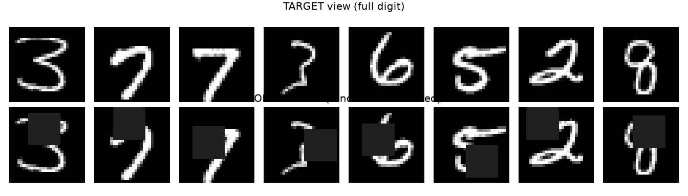
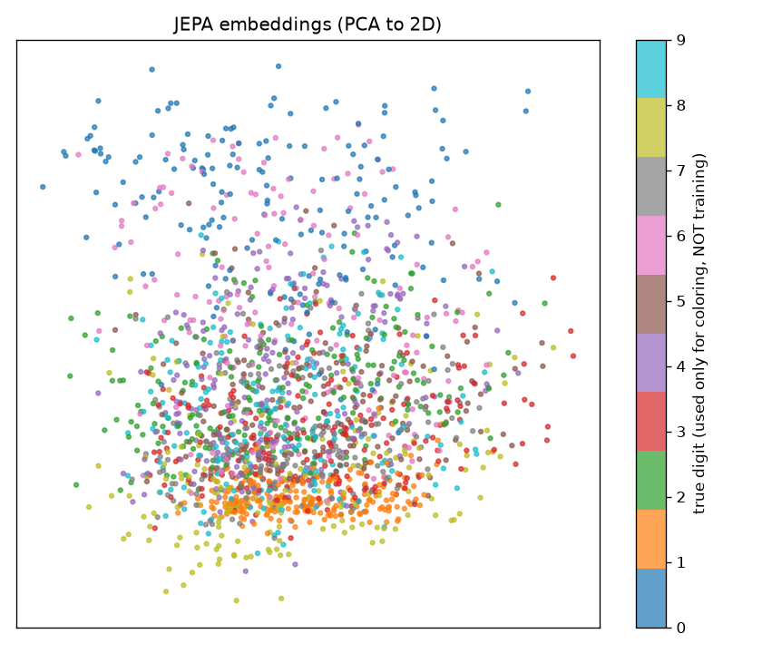
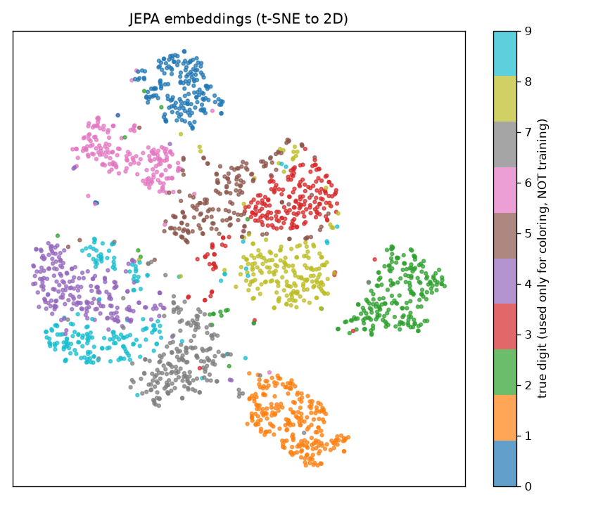
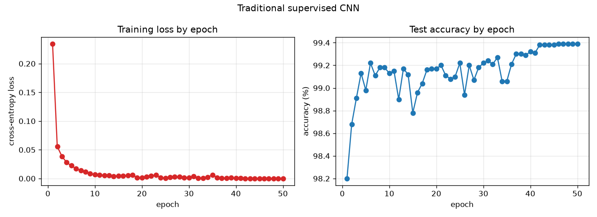
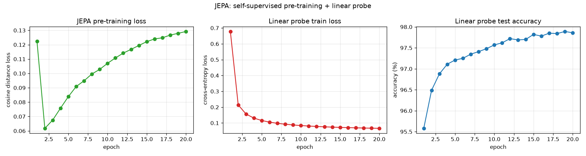

# JEPA on MNIST: a beginner's walkthrough

**Author:** Aditya Wresniyandaka - Summer/Fall 2026

This project explores the core idea behind **JEPA (Joint-Embedding Predictive
Architecture)** by building the smallest useful version of it on MNIST
handwritten digits, and contrasting it with the traditional supervised neural
network you probably already know.

You do **not** need to know JEPA in advance. By the end you'll understand:

- How a normal classifier learns compared to how JEPA learns,
- Why JEPA predicts in *embedding space* instead of *pixel space*,
- The one trick (stop-gradient plus an EMA target) that keeps JEPA from cheating, and
- How to *see* that JEPA learned something useful without ever using labels.

### A quick word on EMA (you'll need it below)

**EMA** stands for **Exponential Moving Average**. It is just a running average
that leans heavily on its own past and only nudges slightly toward each new
value. The update rule is:

```
average = 0.996 * average + 0.004 * new_value
```

Because the new value only gets a 0.4% vote, the average changes slowly and
smoothly instead of jumping around.

Why does this matter for JEPA? JEPA trains one network (the "online" encoder) to
predict the output of a second network (the "target" encoder). If the target
kept changing quickly, the online network would be chasing a moving goalpost and
never settle. So we build the target encoder as an **EMA of the online
encoder**: it is a slow, smoothed copy that trails behind. This gives the online
network a stable target to aim at, and, as Section 5.3 explains, it is one of the
two things that stop JEPA from collapsing into a useless shortcut. Therefore, if
you remember one detail about the mechanics, make it this one: **the EMA target
is what makes label-free learning stable.**

---

## 1. If you already know traditional neural nets, read this first

Here is the entire difference in one sentence:

> **A traditional classifier needs you to tell it the answer (the digit label)
> for every training image. JEPA never sees a single label. It learns purely
> from the structure of the images themselves.**

Think about what you do today to train an MNIST classifier. For all 60,000
training images you provide an `(image, label)` pair. The label, such as "this
is a 3", is the *only* thing that tells the network what to learn. Remove the
labels and a traditional network has nothing to train on.

JEPA removes exactly that requirement. You hand it the *same 60,000 images with
no labels at all*, and it still learns features that separate 0s from 1s from
9s. It does this by playing a game with itself: hide part of an image, then
predict the *meaning* (the embedding) of the full image from the part it can
still see. Nobody ever tells it which digit is which. The digit identity
*emerges* from learning to fill in what's missing.

**How we prove it worked:** after that label-free training, we freeze JEPA and
train one tiny `Linear(→10)` layer on top *using labels*. That is the only place
labels ever appear, and it is just a measuring stick. If a single linear layer
on frozen features hits about 98% accuracy, then the features must have already
organized themselves by digit, on their own.

So the mental shift for a traditional-NN person is:

- **Traditional:** labels *drive* learning. No labels means no learning.
- **JEPA:** data *drives* learning. Labels are optional and only used at the very
  end to *check* (and to attach human-readable names to) what was already learned.

| | Traditional NN | JEPA |
|---|---|---|
| What you feed it | `(image, label)` pairs | images only, **no labels** |
| Input to output | image to label | masked image to embedding of the full image |
| Training signal | the true label you provide | distance between predicted and actual embeddings |
| Where prediction happens | label space | learned **embedding space** |
| Needs labels to learn features? | **yes**, one per image | **no**, labels used only for a final check |
| What it optimizes | "name the digit" | "understand the digit from context" |
| Remove all labels? | can't train at all | trains exactly the same |

---

## 2. Project structure

```
Your_folder/
  data.py            # shared MNIST loading (download + normalize)
  traditional_nn.py  # the familiar approach: image -> label (supervised)
  jepa_mnist.py      # JEPA pre-training + linear probe; saves jepa_encoder.pt
  visualize.py       # makes the figures used in this document
  jepa_encoder.pt    # a trained encoder (created by running jepa_mnist.py)
  viz_masking.png            # target vs context (masked) views
  viz_embeddings_pca.png     # learned embeddings in 2D (PCA)
  viz_embeddings_tsne.png    # learned embeddings in 2D (t-SNE)
  traditional_nn_metrics.png # traditional: loss & accuracy by epoch
  jepa_mnist_metrics.png     # JEPA: pre-train loss + probe loss/accuracy by epoch
```

---

## 3. Setup and how to run

You need Python with `torch`, `torchvision`, `matplotlib`, `scikit-learn`, and
`numpy`. If you already have a PyTorch environment, use it. Otherwise:

```bash
pip install torch torchvision matplotlib scikit-learn numpy
```

Then run the pieces in this order:

```bash
python traditional_nn.py   # 1) the familiar baseline
python jepa_mnist.py       # 2) self-supervised JEPA + linear probe (saves the encoder)
python visualize.py        # 3) generate the figures below
```

MNIST downloads automatically the first time (about 12 MB) into `./data`.

> **GPU note.** Every script auto-selects a GPU when one is present via
> `device = "cuda" if torch.cuda.is_available() else "cpu"`, so on a GPU
> machine it just works with no edits. Look for the `# GPU NOTE:` comments to
> see the explicit `.to("cuda")` form if you ever want to force it.

---

## 4. The traditional network (`traditional_nn.py`)

A small CNN maps an image straight to 10 class scores and is trained with the
standard cross-entropy loss against the true labels:

```
image  ->  conv layers  ->  flatten  ->  linear  ->  10 scores (0..9)
                         cross-entropy(scores, true label)
```

This is fast and accurate. In our runs it reached about **98% test accuracy
after a single epoch**. The catch, and the whole reason JEPA exists, is that
**every one of those 60,000 training images had to come with a label**. The
cross-entropy loss literally cannot be computed without the true digit. Take the
labels away and this network has no training signal at all. The features it
learns also exist *only* to serve the "which digit" task, therefore they are
shaped by the answer key rather than by the data itself.

Running the script now also saves `traditional_nn_metrics.png`, showing training
loss and test accuracy by epoch.

---

## 5. JEPA (`jepa_mnist.py`)

### 5.1 The three parts

1. **Context encoder (online)** sees a *masked* image (a random square is
   erased). This is the "context".
2. **Target encoder** sees the *full* image (the "target"). It is a slow
   copy of the context encoder (see 5.3) and we never send gradients through it.
3. **Predictor** is a small MLP that takes the context embedding and tries to
   predict the target embedding.

```
masked image --[context encoder]--> z_context --[predictor]--> z_pred
full image   --[target  encoder]--> z_target   (no gradients / stop-grad)

loss = distance( z_pred , z_target )   # measured in embedding space
```

Two things to notice:

- The loss lives in **embedding space**, not pixel space. JEPA never tries to
  redraw the erased pixels; it only has to predict their *meaning*. This is the
  central JEPA idea: skip the unpredictable low-level details and keep the
  concept.
- **No labels appear anywhere** in this loop. The digit's identity is never used.

### 5.2 What "predict the target from the context" looks like

The top row is the full **target** view; the bottom row is the masked
**context** view the online encoder actually receives. JEPA must infer the
target's *embedding* from this partial view.



### 5.3 Why it doesn't cheat (representation collapse)

There is a lazy "solution" that would make the loss zero: map *every* image to
the *same* constant vector. Then the prediction always matches the target and
the network learns nothing. This failure is called **representation collapse**.

Two design choices prevent it:

- **Stop-gradient**: the target encoder runs under `torch.no_grad()`. We never
  let the target move to meet the prediction. Instead, the prediction must move
  to meet a stable target.
- **EMA target**: the target encoder's weights are an *exponential moving
  average* of the online encoder's weights (this is the EMA from the
  introduction): `target = 0.996 * target + 0.004 * online`. It changes slowly,
  therefore it gives the online network a steady goal to chase.

This asymmetry (a predictor on one side plus a slow EMA target on the other) is
the same recipe used by BYOL and Meta's I-JEPA. If you set the EMA momentum to 0
you break the trick on purpose. Try it and watch the clusters in 5.4 collapse
into a single blob.

### 5.4 Did it actually learn anything? The linear probe

Since JEPA used no labels, how do we know its features are good? We **freeze**
the encoder and train only a single `Linear(embedding -> 10)` layer on top,
using labels. If a mere linear layer on frozen features classifies digits well,
then the features must already separate the classes. Note how little this layer
can do: it cannot learn new features, only draw straight boundaries through the
ones JEPA already built. So its accuracy is a direct measure of how good those
label-free features are.

In our runs, after **20 epochs** of label-free pre-training, this linear probe
reaches about **98% test accuracy**, essentially matching the fully supervised
CNN, from features that never saw a single label during training. (With only 1
or 2 pre-training epochs it starts around 85% and climbs from there as you train
longer.)

Running the script now also saves `jepa_mnist_metrics.png`, showing the JEPA
pre-training loss, the linear-probe training loss, and the linear-probe test
accuracy, all by epoch.

---

## 6. What the visualizations prove

### 6.1 The embedding maps

Each JEPA embedding is a vector with 128 numbers, so we cannot look at it
directly. To put it on a flat page we have to **squash 128 dimensions down to
2**. That squashing is what PCA and t-SNE do, and each one answers a slightly
different question. In both plots, every dot is one test image, positioned by
its (reduced) JEPA embedding and **colored by its true digit label**. The labels
are used *only to color the dots*, never during training. If same-colored dots
clump together, JEPA separated the digits on its own.

**PCA to 2D** (a fast linear projection):



PCA keeps the two directions along which the embeddings vary the most and throws
the rest away. It is linear, so it never distorts distances: points that are far
apart in the full 128-D space stay far apart on the page, and points that are
close stay close. That honesty is also its weakness. Squeezing 128 dimensions
into 2 straight lines loses a lot, so clusters often look smeared or partly
overlapping even when they are cleanly separated in the original space. Read PCA
as a faithful but blurry overview of the *global* shape.

**t-SNE to 2D** (a slower nonlinear method):



t-SNE asks a different question: for each point, which points were its nearest
neighbors in the full 128-D space? It then arranges the 2-D layout so those
local neighborhoods stay together, bending space as needed. This is why t-SNE
usually shows tight, well-separated islands. The trade-off is that it is only
trustworthy *locally*: the sizes of the blobs and the gaps between them are not
meaningful, so you should not read "these two clusters are far apart" as a real
distance. Read t-SNE as a sharp view of *local* neighborhood structure.

What are we trying to show with both? That the digit clusters are real and not
an artifact of one drawing method. PCA confirms the structure survives an honest
linear projection, and t-SNE confirms that, up close, images of the same digit
truly are each other's nearest neighbors in JEPA's embedding space. Seeing the
same clusters two different ways is stronger evidence than either plot alone.

### 6.2 How to read them

- **Clear, well-separated color blobs** (such as 1s, 2s, 0s, and 6s) mean the
  self-supervised features already encode digit identity.
- **Neighboring or overlapping blobs** (such as 4 and 9, or 3, 5, and 8) are
  digits that genuinely look similar when partially masked. These are exactly
  the mistakes you would expect, which is a sign the representation is meaningful
  rather than random.

This is the whole point of the project made visible: **structure emerged from
data alone**, without labels. The traditional network can only produce such
structure *because* we handed it the labels; JEPA discovered it.

---

## 7. Results summary

Approximate numbers from runs in this project (yours will vary a bit):

| Approach | Labels used to learn features | Test accuracy |
|---|---|---|
| Traditional CNN (1 epoch) | all 60,000 | ~98% |
| Traditional CNN (after 40 epochs) | all 60,000 | ~99.4% |
| JEPA pre-train + **linear probe** (~2 epochs pre-train) | **none** | ~92% |
| JEPA pre-train + **linear probe** (20 epochs pre-train) | **none** | **~98%** |

Read that last row carefully. JEPA reaches roughly the **same ~98% accuracy** as
the fully supervised CNN, but it learned its features **without ever being told
which digit was which**. The only labels in the entire JEPA pipeline are the
handful used to train the final one-layer probe, and that layer does no real
feature learning; it just reads out what JEPA already discovered.

That is the whole promise of self-supervised learning: learn general
representations from unlabeled data (which is abundant), then attach labels only
at the very end to point those representations at a specific task (labels are
expensive). Traditional supervised learning needs a label for every example, all
the way through. JEPA needs almost none.

### 7.1 The training curves

Each script saves its own metrics chart so you can watch learning happen epoch
by epoch, not just read the final number.

**Traditional CNN** (`traditional_nn_metrics.png`): training loss on the left,
test accuracy on the right.



The story here is speed. The loss drops steeply in the first couple of epochs
and accuracy is already near its ceiling almost immediately, because the labels
hand the network a direct answer to copy. After that the curve is mostly flat,
squeezing out the last fraction of a percent. This is what "learning from the
answer key" looks like: fast, and pointed straight at the metric we chose.

**JEPA** (`jepa_mnist_metrics.png`): three panels, left to right are the
self-supervised pre-training loss, the linear-probe training loss, and the
linear-probe test accuracy.



Read this left to right, because it mirrors the two-stage pipeline. The **left
panel** is the label-free part: the pre-training loss falls as JEPA gets better
at predicting the embedding of the full image from a masked view. Notice that
this curve knows nothing about digits; it is measured entirely in embedding
space. The **middle and right panels** are the later mini-quiz, where a single
linear layer is trained on the frozen features. Its accuracy climbs quickly and
settles near 98%, which is the payoff: the better the left panel got at its
label-free game, the more separable the features it produced, therefore the
higher the probe on the right can reach.

Put the two figures side by side and the contrast is the whole point of the
project. The traditional model spends every epoch optimizing accuracy directly
with labels. JEPA spends most of its epochs (the left panel) optimizing
something that never mentions a label at all, and still arrives at essentially
the same accuracy once we finally attach the tiny labeled probe.

---

## 8. Experiments to try next

1. **Break the anti-collapse trick.** Set `momentum=0.0` in `pretrain_jepa`,
   retrain, and re-run `visualize.py`. The clusters should collapse, which is the
   fastest way to *feel* why the EMA target matters.
2. **Change the masking difficulty.** In `make_context_view`, try `block=8`
   (easy) compared with `block=20` (hard). Harder masking means a harder
   prediction task.
3. **Train longer.** Bump the pre-training epochs in `jepa_mnist.py` and watch if
   the linear-probe accuracy and the t-SNE clusters improve.
4. **Fewer labels for the probe.** Train the linear probe on only 1% of labels
   to simulate a low-label setting. This is where self-supervision shines.
5. **Go closer to real I-JEPA.** Swap the CNN for a small Vision Transformer and
   predict the embeddings of several masked patch-blocks using their positions.

---

## 9. References

Assran, Mahmoud, Quentin Duval, Ishan Misra, Piotr Bojanowski, Pascal Vincent,
Michael Rabbat, Yann LeCun, and Nicolas Ballas. 2023. "Self-Supervised Learning
from Images with a Joint-Embedding Predictive Architecture." In *Proceedings of
the IEEE/CVF Conference on Computer Vision and Pattern Recognition (CVPR)*.
Preprint, arXiv:2301.08243. https://arxiv.org/abs/2301.08243.

Grill, Jean-Bastien, Florian Strub, Florent Altché, Corentin Tallec, Pierre H.
Richemond, Elena Buchatskaya, Carl Doersch, et al. 2020. "Bootstrap Your Own
Latent: A New Approach to Self-Supervised Learning." In *Advances in Neural
Information Processing Systems 33 (NeurIPS 2020)*. Preprint, arXiv:2006.07733.
https://arxiv.org/abs/2006.07733.

LeCun, Yann. 2022. "A Path Towards Autonomous Machine Intelligence." Version
0.9.2, June 27, 2022. OpenReview. https://openreview.net/forum?id=BZ5a1r-kVsf.

---

## 10. Declaration on the use of Generative AI

This README was written and polished with the help of a generative AI coding
assistant. The author directed the structure, decided what to include, supplied
the experimental results and numbers reported here, and reviewed and approved
the final text. The AI assistant helped draft explanations, tighten wording, and
format the document (including this reference list). All technical claims and
results were verified by the author before publication. Any remaining errors are
the author's own.

---

## 11. Disclaimer

This project is **experimental and educational**. It exists to make the core
JEPA idea easy to read and run, therefore it is **not intended for production
use**. Expect the usual consequences of that goal:

- **Flat structure by design.** Everything (code, saved model, and images) lives
  in a single folder with no subdirectories. A production project would separate
  concerns into folders such as `src/`, `models/`, and `assets/` or `images/`,
  add packaging, tests, and configuration, and avoid committing generated
  artifacts. Here we keep it flat so every file is one click away and the whole
  project reads top to bottom.
- **Small and simplified.** The model, dataset, and training loop are deliberately
  tiny so the ideas stay visible. They skip the robustness, error handling,
  logging, and tuning you would want in real software.
- **Numbers will vary.** The reported accuracies are approximate and depend on
  hardware, library versions, and random seeds. Treat them as illustrative
  rather than benchmark results.

Use it to learn and experiment, not as a template for a production system.

---

## 12. How to cite this work

If you use or reference this project, please cite it. 

```bibtex
@software{wresniyandaka_jepa_mnist,
  author  = {Wresniyandaka, Aditya},
  title   = {JEPA on MNIST: A Beginner's Walkthrough},
  year    = {2026},
  url      = {https://github.com/adityatw/jepa_mnist},
  version = {1.0},
  note    = {Educational implementation of a minimal JEPA on MNIST}
}
```

---

*Copyright © 2026 Aditya Wresniyandaka. All rights reserved.*
